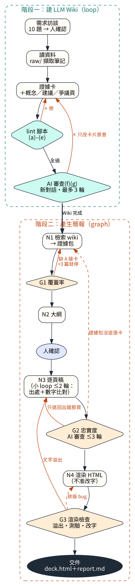

# 語言怎麼學才有效？— LLM Wiki × 教學 HTML 簡報

生成式 AI 課程第 10 週作業：先用「先討論、後生成」建立 LLM Wiki，再用 graph 流程從 Wiki 產生教學 HTML 簡報。

- **主題**：語言學習方法（記憶與複習＋輸入與輸出），寫給沒學過語言學習理論的一般人
- **簡報**：[`topic-language-learning/deck.html`](topic-language-learning/deck.html)（← → 翻頁；右下角「出處」可看原文關鍵句）
- **Wiki 入口**：[`wiki/index.md`](wiki/index.md)｜員工手冊：[`AGENTS.md`](AGENTS.md)｜需求訪談：[`docs/interview.md`](docs/interview.md)

## 規模
12 篇資料（A 級 10、B 級 1、C 級 1）→ 51 條證據卡 → 40 個 Wiki 頁面 → 12 頁簡報（每個內容頁都可追溯到證據卡）

## 資料夾
```
AGENTS.md                Wiki 規則（CLAUDE.md 只寫 @AGENTS.md）
docs/                    需求訪談、流程圖
raw/                     原始資料擷取筆記（不放全文）
wiki/                    sources / cards / concepts / advice / debates / index / log
tools/                   lint_wiki · build_index · retrieve · gate_coverage · check_drafts · build_deck · check_deck
.agents/workflows/       topic-slides.md（簡報 graph 規格）
topic-language-learning/ plan · sources(證據包) · outline · drafts/ · deck.html · report.md · screens/
```

## Loop / Graph


- **Wiki 階段是 loop**：ingest → lint 腳本 → AI 審查（新對話，最多 3 輪）→ 不過就改回卡片原意
- **簡報階段是 graph**：檢索 → 覆蓋率關卡 → 大綱 → 人確認 → 逐頁稿（每頁小 loop）→ 忠實度關卡 → 渲染 → 渲染檢查；錯在哪關退回哪關
- 檢查紀錄：[`wiki/log.md`](wiki/log.md)、[`topic-language-learning/report.md`](topic-language-learning/report.md)、[`docs/commit-history.md`](docs/commit-history.md)（本機 git 紀錄匯出）
- workflow 規格：[`.agents/workflows/topic-slides.md`](.agents/workflows/topic-slides.md)

## 重跑
```bash
python3 tools/lint_wiki.py
python3 tools/retrieve.py topic-language-learning && python3 tools/gate_coverage.py topic-language-learning
python3 tools/check_drafts.py topic-language-learning
python3 tools/build_deck.py topic-language-learning && python3 tools/check_deck.py topic-language-learning   # 需 playwright
```
